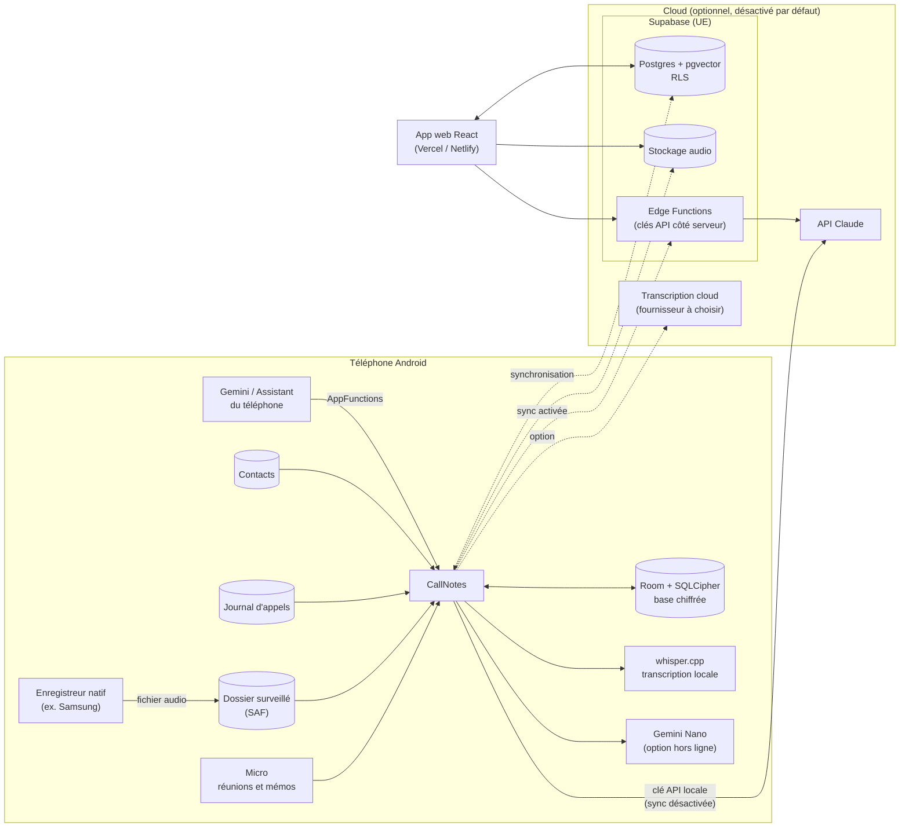
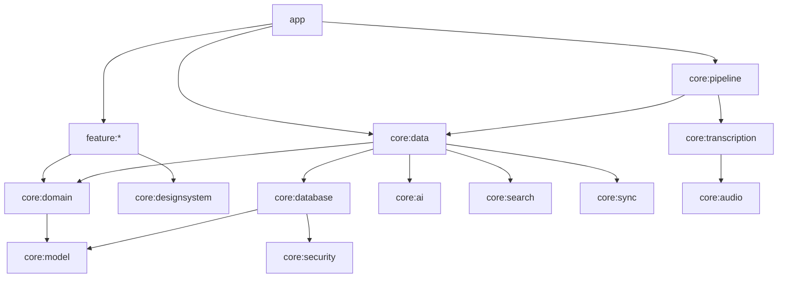
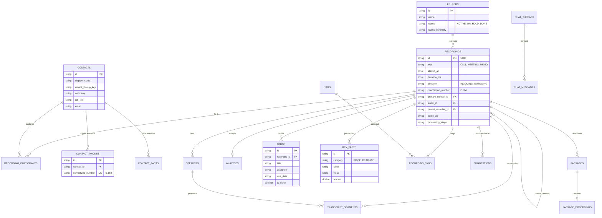
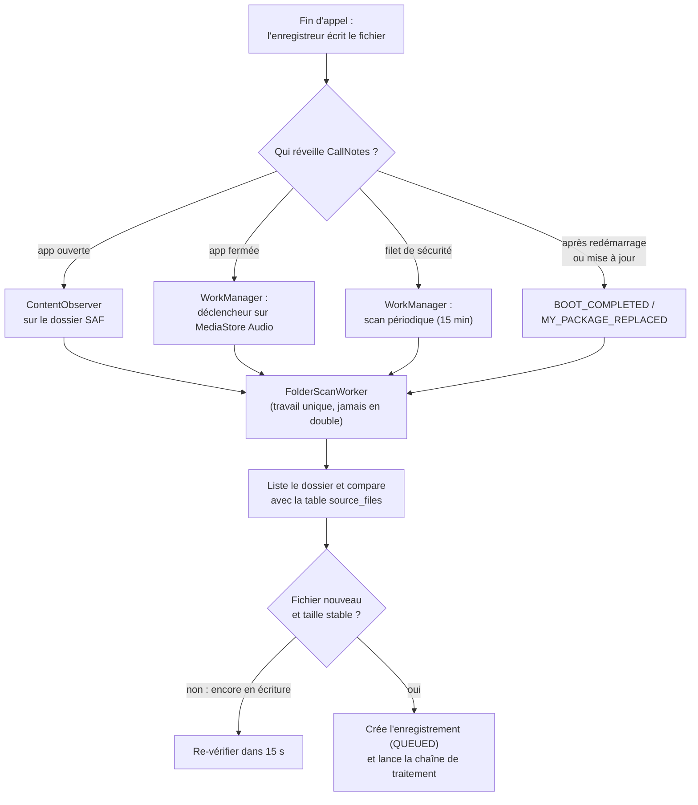
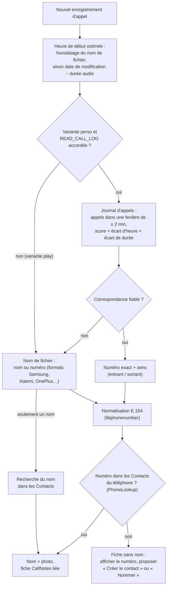
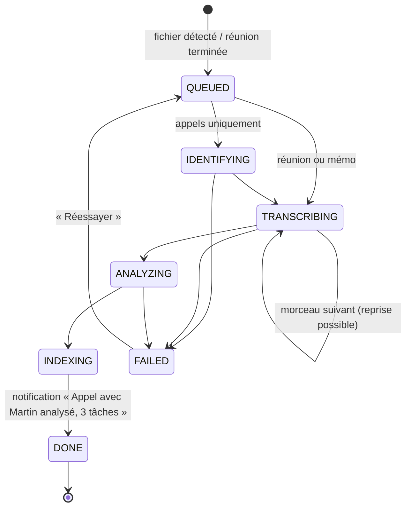
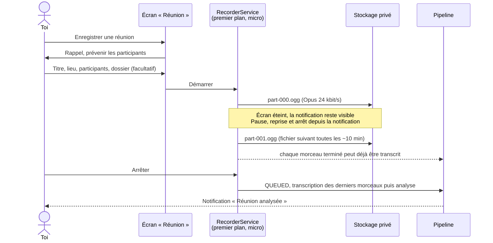
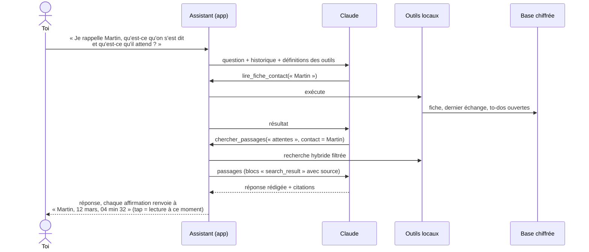
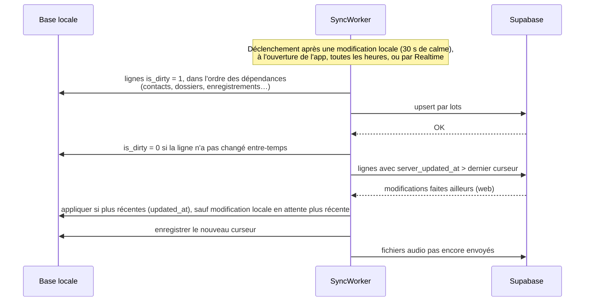

# CallNotes — Architecture (étape 1)

> Journal d'appels, de réunions et de mémos vocaux, avec analyse IA et un assistant pour interroger le tout.
> Android natif (Kotlin, Jetpack Compose, Material 3), Android 13 minimum, cible Android 17 (API 37).
> Version web (React + Vite) en option, synchronisée par Supabase.

Ce document décrit **ce qui sera construit et comment les pièces s'assemblent**. Il sert de référence pour toutes les étapes suivantes. Les points qui demandent ton arbitrage sont regroupés au § 15 « Décisions à valider ».

## Sommaire

1. [Principes directeurs](#1-principes-directeurs)
2. [Vue d'ensemble](#2-vue-densemble)
3. [Modules Gradle](#3-modules-gradle)
4. [Modèle de données](#4-modèle-de-données)
5. [Flux sur le téléphone](#5-flux-sur-le-téléphone)
6. [Moteur IA](#6-moteur-ia)
7. [Synchronisation et version web](#7-synchronisation-et-version-web)
8. [Sécurité et confidentialité](#8-sécurité-et-confidentialité)
9. [Intégration au système et aux IA du téléphone](#9-intégration-au-système-et-aux-ia-du-téléphone)
10. [Interface et navigation](#10-interface-et-navigation)
11. [Variantes « perso » et « play », permissions](#11-variantes-perso-et-play-permissions)
12. [Pile technique](#12-pile-technique)
13. [Tests et intégration continue](#13-tests-et-intégration-continue)
14. [Limites connues et risques](#14-limites-connues-et-risques)
15. [Décisions à valider](#15-décisions-à-valider)
16. [Plan des étapes](#16-plan-des-étapes)

---

## 1. Principes directeurs

| Principe | Conséquence concrète |
|---|---|
| **Local d'abord** | La base Room du téléphone est la source de vérité. Tout fonctionne hors ligne (sauf l'IA cloud). La synchronisation n'est qu'une copie. |
| **Rien dans le cloud sans accord explicite** | IA cloud, transcription cloud et synchronisation sont trois interrupteurs distincts, tous désactivés par défaut. |
| **Aucune action de ta part pour les appels** | Détection automatique du nouveau fichier, traitement complet en arrière-plan, notification discrète à la fin. |
| **Pipeline reprenable** | Chaque étape (identification → transcription → analyse → indexation) est idempotente et enregistre son avancement en base. Si Android tue l'app, le travail reprend là où il s'était arrêté. |
| **L'IA propose, tu disposes** | Rattachement à un dossier, mises à jour de fiche contact, actions de l'assistant : tout passe par une confirmation d'un tap. |
| **IA interchangeable** | Les écrans et le pipeline ne connaissent qu'une interface ; Claude (cloud) et Gemini Nano (sur l'appareil) en sont deux implémentations. |
| **Prêt pour Google Play** | Deux variantes de compilation dès maintenant : `perso` (journal d'appels) et `play` (sans permission restreinte). |

---

## 2. Vue d'ensemble



---

## 3. Modules Gradle

Organisation inspirée de l'app de référence Google « Now in Android » : des modules `core` (socle réutilisable) et des modules `feature` (un par écran principal). Avantages : compilation incrémentale plus rapide, dépendances explicites, logique métier testable sans émulateur.

```
CallNotes/
├── app/                      Application, navigation, assemblage Hilt, widgets, tuile, raccourcis
├── core/
│   ├── model/        (JVM)   Modèles du domaine (Kotlin pur)
│   ├── domain/       (JVM)   Contrats des repositories + logique métier pure
│   ├── database/             Room + SQLCipher : entités, DAO, migrations
│   ├── data/                 Implémentations des repositories
│   ├── security/             Android Keystore, clé de la base, clé API, biométrie
│   ├── designsystem/         Thème Material 3, composants Compose partagés
│   ├── audio/                Décodage (MediaCodec → PCM 16 kHz), découpage, enregistreur micro
│   ├── transcription/        whisper.cpp (JNI/NDK), moteur cloud, distinction des voix
│   ├── ai/                   Abstraction IA : Claude, Gemini Nano, outils de l'assistant
│   ├── search/               Passages, embeddings, recherche hybride
│   ├── pipeline/             WorkManager : surveillance du dossier, chaîne de traitement, notifications
│   └── sync/                 Supabase : envoi / réception, stockage audio
├── feature/
│   ├── feed/                 Fil chronologique + recherche
│   ├── recording/            Fiche d'enregistrement (lecteur synchronisé, to-dos, points clés)
│   ├── folders/              Dossiers
│   ├── contacts/             Fiches contacts enrichies
│   ├── todos/                To-dos
│   ├── assistant/            « Demande à tes appels »
│   ├── recorder/             Réunions et mémos (service au premier plan)
│   ├── onboarding/           Premier lancement : permissions, dossier, modèle Whisper
│   └── settings/             Réglages, confidentialité, RGPD
├── web/                      App web React + Vite (étape 6)
├── supabase/                 Migrations SQL, Edge Functions (étape 6)
├── shared/ai/                Prompts, schémas JSON et définitions d'outils partagés Android ↔ serveur (étape 3)
└── docs/
```

**Créés à l'étape 1** : `app`, `core:model`, `core:domain`, `core:database`, `core:data`, `core:security`, `core:designsystem`, `feature:feed`. Les autres modules naissent à l'étape qui les utilise : pas de module vide.



Règle : un module `feature` ne dépend **jamais** d'un autre module `feature`, ni directement de `core:database`. Il ne voit que les contrats de `core:domain`.

---

## 4. Modèle de données

### 4.1 Diagramme



Le schéma complet est dans le code : `core/database/src/main/kotlin/app/callnotes/core/database/entity/`.

### 4.2 Tables

| Table | Rôle | Synchronisée |
|---|---|---|
| `recordings` | Un appel, une réunion ou un mémo : type, date, durée, sens, numéro, contact principal, dossier, mémo parent, fichier audio, étape de traitement | oui |
| `recording_participants` | Lien n–n enregistrement ↔ contacts, avec le rôle (interlocuteur, participant, mentionné) | oui |
| `speakers` | Voix distinguées (« Moi », « Interlocuteur », « Intervenant 2 »), renommables, liables à un contact | oui |
| `transcript_segments` | Transcription horodatée, segment par segment | oui |
| `analyses` | Résumé 3–5 lignes, résumé en une ligne, questions en suspens, moteur et modèle utilisés, JSON brut validé | oui |
| `todos` | Action, qui, échéance (date + texte prononcé), fait/pas fait, moment de l'audio, événement d'agenda créé | oui |
| `key_facts` | Prix, quantités, dates, délais, adresses, engagements ; montant numérique, unité, devise ; rattachés au contact et au dossier | oui |
| `tags`, `recording_tags` | Tags automatiques ou manuels | oui |
| `suggestions` | Propositions de l'IA en attente : rattacher à un dossier, créer un dossier, compléter une fiche contact | oui |
| `folders` | Dossiers : nom, statut, mots-clés, résumé « Où en est ce dossier ? » | oui |
| `contacts`, `contact_phones`, `contact_facts` | Fiches enrichies, numéros regroupés, infos utiles retenues | oui |
| `chat_threads`, `chat_messages` | Conversations avec l'assistant, avec leurs citations | oui |
| `passages`, `passages_fts`, `passage_embeddings` | Index de recherche (texte découpé, plein texte, vecteurs) | **non** (données dérivées, recalculées) |
| `source_files` | Fichiers vus dans le dossier surveillé : évite les doublons, garde les erreurs | **non** (propre au téléphone) |

### 4.3 Règles communes

- **Identifiants** : UUID texte générés sur l'appareil. Téléphone et web créent des lignes sans risque de collision.
- **Métadonnées de synchronisation** (sur chaque table synchronisée) : `created_at`, `updated_at`, `deleted_at` (suppression douce propagée aux autres appareils puis purgée), `is_dirty` (à envoyer au serveur).
- **Dates** en millisecondes UTC ; échéances en date ISO (`2026-11-03`) pour rester triables.
- **Numéros** : toujours normalisés au format E.164 avec libphonenumber (région par défaut : celle de la carte SIM, sinon FR). L'index unique `contact_phones.normalized_number` garantit qu'un numéro n'appartient qu'à une seule fiche : « 06 12 34 56 78 » et « +33 6 12 34 56 78 » tombent sur le même contact.
- **Un numéro inconnu crée quand même une fiche** (sans nom). Elle peut ensuite être nommée dans l'app ou reliée à un contact du téléphone créé à cette occasion.
- **Plein texte** : FTS4 avec `unicode61 remove_diacritics=2`, pour que « café » trouve « cafe ».
- **Évolution** : chaque changement de schéma incrémente la version Room avec une migration testée ; les schémas sont exportés en JSON dans `core/database/schemas/`.

---

## 5. Flux sur le téléphone

### 5.1 Détection automatique d'un nouvel appel

L'app ne peut pas enregistrer l'audio des appels (interdit par Android et Google Play). C'est l'enregistreur natif qui dépose un fichier ; CallNotes le repère et le traite.

**Choix du dossier (premier lancement)** — sélecteur système (Storage Access Framework, `ACTION_OPEN_DOCUMENT_TREE`), ouvert directement sur le dossier probable grâce à `EXTRA_INITIAL_URI` :

| Fabricant | Dossiers connus (à confirmer sur ton appareil) |
|---|---|
| Samsung (One UI 4 et +) | `Recordings/Call` |
| Samsung (anciens One UI) | `Call` |
| Xiaomi / Redmi / POCO (MIUI, HyperOS) | `MIUI/sound_recorder/call_rec` |
| OnePlus / OPPO / realme (ColorOS, OxygenOS 12 et +) | `Music/Recordings/Call Recordings`, `Recordings/Call Recordings` |
| OnePlus (OxygenOS 11 et avant) | `Record/PhoneRecord` |
| Google Téléphone (Pixel) | Enregistrements stockés **dans l'app Téléphone elle-même**, inaccessibles aux autres apps : utiliser « Partager → CallNotes » (voir § 14) |

L'autorisation d'accès au dossier est rendue permanente (`takePersistableUriPermission`) : elle survit aux redémarrages.

**Surveillance : quatre mécanismes complémentaires**, parce qu'aucun n'est fiable seul sur tous les téléphones :



- **Déclencheur MediaStore** : WorkManager sait lancer un travail quand un fichier audio apparaît sur le téléphone (`addContentUriTrigger`), même app fermée. Le travail se réarme à chaque exécution.
- **Scan périodique** : garanti par WorkManager, y compris après un redémarrage et en mode Doze (dans les fenêtres de maintenance).
- **Optimisation de la batterie** : l'onboarding demande l'exemption (`REQUEST_IGNORE_BATTERY_OPTIMIZATIONS`, variante perso) et explique, pour Samsung, comment placer CallNotes dans « Applis jamais en veille ».
- **Fichier en cours d'écriture** : on ne traite qu'un fichier dont la taille n'a pas bougé entre deux lectures espacées.
- **Secours** : import manuel (sélecteur de fichiers) et cible de partage Android (« Partager → CallNotes »).

### 5.2 Identification de l'interlocuteur



- Le score combine l'écart entre l'heure de début de l'appel (`CallLog.Calls.DATE`) et celle de l'enregistrement, et l'écart de durée (`CallLog.Calls.DURATION` ≈ durée audio). Un appel manqué ou rejeté (durée nulle) est exclu.
- « Créer le contact » ouvre le formulaire du téléphone pré-rempli (`ACTION_INSERT`) : **aucune permission d'écriture** sur les contacts n'est nécessaire.
- L'origine de l'identification est conservée (`identification_source`) et toujours corrigeable à la main.

### 5.3 Chaîne de traitement



- Chaque étape est un `CoroutineWorker` WorkManager chaîné (`beginUniqueWork(recordingId)`), avec ses contraintes : réseau requis pour l'IA cloud, batterie non faible pour la transcription d'une longue réunion.
- **Limites d'Android sur le travail en arrière-plan** : un travail ordinaire peut être interrompu après une dizaine de minutes. La transcription avance donc **par morceaux** (§ 5.5) et enregistre `transcribed_until_ms` après chaque morceau ; l'exécution suivante reprend à cet endroit. Quand l'app est au premier plan, le travail passe en service au premier plan de type `mediaProcessing` (Android 15+) pour aller plus vite.
- L'analyse attend que l'IA choisie soit disponible (réseau pour Claude, modèle prêt pour Gemini Nano) ; sans moteur IA configuré, l'enregistrement reste transcrit et cherchable.
- Notification discrète (canal à faible importance, contenu masqué sur l'écran verrouillé) avec deux actions : « Voir » et « Ajouter un mémo ».

### 5.4 Réunions et mémos



- **Service au premier plan de type `microphone`**, démarré depuis l'interface (obligatoire sur Android 14+ pour utiliser le micro en arrière-plan) ; il continue écran éteint.
- **Format** : Ogg/Opus mono 16 kHz, environ 11 Mo par heure. Le flux Ogg reste lisible même si l'enregistrement est coupé brutalement (contrairement au MP4/M4A dont l'index est écrit à la fin).
- **Fichiers successifs** (`MediaRecorder.setNextOutputFile`) : une réunion de 2 h ou plus produit une douzaine de morceaux, transcrits au fil de l'eau. Aucun fichier géant à charger en mémoire.
- **Mémos en un geste** : bouton flottant dans l'app, widget, tuile des Réglages rapides, raccourci d'app. Un mémo peut être rattaché à un appel (`parent_recording_id`), à un contact ou à un dossier.
- Titre, lieu, participants (choisis dans les contacts) et dossier sont modifiables avant comme après.

### 5.5 Transcription

| | Sur l'appareil (par défaut) | Cloud (option) |
|---|---|---|
| Moteur | whisper.cpp (NDK/JNI), modèle Whisper quantifié | Fournisseur à choisir (§ 15) : Claude ne transcrit pas l'audio |
| Confidentialité | L'audio ne quitte pas le téléphone | Audio envoyé au fournisseur, après accord explicite |
| Usage conseillé | Appels courants | Longues réunions, meilleure précision |

- **Décodage** : `MediaExtractor` + `MediaCodec` → PCM mono 16 kHz (format attendu par Whisper), quel que soit le format d'origine (M4A/AAC, MP3, AMR, Ogg/Opus, WAV).
- **Découpage** : morceaux de quelques minutes coupés sur les silences grâce à la détection d'activité vocale (VAD Silero intégrée à whisper.cpp). Les silences sont sautés, ce qui accélère le traitement.
- **Horodatage** : chaque segment garde son début et sa fin, décalés de la position du morceau. Un tap sur une phrase fait sauter le lecteur à ce moment.
- **Modèle** : téléchargé au premier usage (empreinte SHA-256 vérifiée), pas embarqué dans l'APK. Choix proposé : `base` (≈ 60 Mo, rapide), `small` (≈ 180 Mo, par défaut), `large-v3-turbo` (≈ 550 Mo, précis). La vitesse réelle sera mesurée sur ton téléphone à l'étape 2.
- **Distinction des voix** :
  - Appels : 2 voix. Si le fichier est en stéréo avec un côté par interlocuteur, la séparation est exacte ; sinon, regroupement des segments par empreinte vocale (2 groupes). « Moi » est reconnu en comparant à un court échantillon de ta voix enregistré à l'onboarding.
  - Réunions : regroupement automatique → « Intervenant 1, 2, 3… ».
  - Les noms se corrigent à la main (table `speakers`), et peuvent être liés à un contact.
  - Outil envisagé : sherpa-onnx (segmentation + empreinte vocale, hors ligne) — à valider (§ 15).

### 5.6 Analyse IA

Lancée automatiquement à la fin de la transcription. Entrée : la transcription (avec voix et horodatages), le type d'enregistrement, le contact identifié, la liste compacte des dossiers ouverts (nom + mots-clés) et la date du jour (pour interpréter « vendredi prochain »).

**Sortie : JSON structuré** (schéma versionné, partagé avec le serveur dans `shared/ai/`). Avec Claude, le format est imposé par les *structured outputs* de l'API (`output_config.format` avec un schéma JSON) ; dans tous les cas la réponse est **validée** (types, champs obligatoires, horodatages existants, identifiants de dossier connus) avant écriture en base. En cas d'échec : une nouvelle tentative avec le message d'erreur, puis étape `FAILED` avec bouton « Réessayer ».

```json
{
  "schema_version": 1,
  "summary": "3 à 5 lignes",
  "one_line_summary": "Une ligne pour le fil",
  "todos": [
    { "action": "Envoyer le devis carrelage", "assignee": "Moi", "assignee_is_me": true,
      "due_date": "2026-11-03", "due_text": "avant lundi", "source_ms": 245000 }
  ],
  "key_facts": [
    { "category": "PRICE", "label": "Carrelage posé", "value": "45 € HT le m²",
      "amount": 45, "unit": "m²", "currency": "EUR", "source_ms": 182000 }
  ],
  "open_questions": ["Le délai de livraison du carrelage est-il confirmé ?"],
  "tags": ["devis", "carrelage"],
  "folder_suggestion": { "existing_folder_id": "…", "new_folder_name": null, "reason": "…" },
  "contact_updates": [
    { "field": "EMAIL", "value": "martin@exemple.fr", "evidence": "…", "source_ms": 300000 }
  ],
  "contact_facts": [ { "text": "Préfère être appelé le matin", "source_ms": 512000 } ]
}
```

- To-dos, points clés et tags sont écrits directement (modifiables ensuite). **Le dossier et les mises à jour de fiche contact deviennent des `suggestions`** affichées en cartes « Confirmer / Ignorer ».
- **Longues réunions** : si la transcription dépasse ce que le moteur accepte (cas de Gemini Nano, dont le contexte est court), analyse en deux temps : un résumé partiel par morceau, puis une synthèse.
- **Résumé de dossier** « Où en est ce dossier ? » : régénéré après chaque nouvel enregistrement rattaché, à partir des résumés et des to-dos ouvertes du dossier (jamais de toutes les transcriptions).

### 5.7 Indexation et recherche hybride

- **Passages** : la transcription est découpée en passages d'environ 150 à 250 mots, alignés sur les segments, avec un léger chevauchement. Chaque passage garde l'enregistrement, ses horodatages de début et de fin ; contact, numéro, dossier et date se retrouvent par jointure (donc toujours à jour si tu changes un rattachement).
- **Plein texte** : FTS4 (table `passages_fts`).
- **Sémantique** : un modèle d'embedding multilingue **sur l'appareil** calcule un vecteur par passage (table `passage_embeddings`).
- **Fusion** : *Reciprocal Rank Fusion* des deux classements, après filtrage automatique : si la question cite une personne, un numéro, un dossier ou une période, la recherche est restreinte aux enregistrements correspondants **avant** le calcul.

> **À propos de sqlite-vec** : la recherche de sqlite-vec est une comparaison exhaustive (pas d'index approximatif). La faire en Kotlin sur des vecteurs stockés dans la base chiffrée donne exactement le même résultat, sans extension native à compiler dans SQLCipher : quelques dizaines de millisecondes pour 100 000 passages, après filtrage. Je propose donc cette solution en v1, derrière une interface `VectorIndex` qui permettra de brancher sqlite-vec si on parvient à le charger dans SQLCipher (à évaluer à l'étape 3, voir § 15). Côté serveur, pgvector comme prévu.

### 5.8 Assistant « Demande à tes appels »



**Outils (tool use)**

| Outil | Rôle |
|---|---|
| `chercher_passages` | Recherche hybride, filtres facultatifs : contact, numéro, dossier, période, type |
| `lire_enregistrement` | Métadonnées, résumé, to-dos, points clés, extrait de transcription autour d'un instant |
| `lister_enregistrements_contact` | Derniers échanges avec une personne |
| `lire_dossier` | Fiche du dossier, chronologie, to-dos ouvertes, résumé d'avancement |
| `lire_fiche_contact` | Fiche enrichie : entreprise, rôle, infos retenues, dossiers liés |
| `historique_prix` | Prix, délais et engagements cités, avec date et source |
| `lister_todos` | To-dos filtrées (statut, échéance, contact, dossier) |
| `proposer_todo`, `proposer_rendez_vous` | **Actions** : l'app affiche une carte de confirmation ; rien n'est créé sans ton tap |

- **Seuls les résultats des outils partent vers l'IA**, jamais la base entière. Les résultats sont plafonnés en taille.
- **Citations** : les passages sont renvoyés comme blocs `search_result` (source = `callnotes://recording/{id}?t={ms}`), ce qui permet à Claude de citer précisément ses sources ; l'app transforme chaque citation en lien vers la fiche, au bon moment de l'audio.
- **Pas d'invention** : le prompt système impose de répondre uniquement à partir des résultats d'outils et de dire « je n'ai rien trouvé » sinon.
- **Conversation suivie** : l'historique est conservé (`chat_threads`, `chat_messages`) et renvoyé à chaque tour.
- **Questions suggérées** sur l'écran d'accueil, générées à partir des données récentes (« Qu'ai-je promis cette semaine ? », « Où en est le dossier Dupont ? »).
- **Saisie vocale** : reconnaissance vocale du téléphone (`SpeechRecognizer`, hors ligne si la langue est installée).
- **Avec Gemini Nano** (pas d'outils) : mode simplifié, l'app fait elle-même la recherche hybride puis demande une réponse citée à partir des meilleurs passages.

---

## 6. Moteur IA

Contrats (à affiner à l'étape 3) :

```kotlin
/** Un moteur de langage : Claude (cloud) ou Gemini Nano (appareil). */
interface AiEngine {
    val id: AiEngineId                      // CLAUDE, GEMINI_NANO
    val capabilities: AiCapabilities        // outils ? sortie JSON imposée ? taille de contexte ? hors ligne ?
    suspend fun availability(): Availability // prêt, à télécharger, non pris en charge, pas de clé…
    suspend fun generateStructured(request: StructuredRequest): String  // JSON (analyse)
    fun chat(request: ChatRequest): Flow<ChatEvent>                     // texte en flux, appels d'outils
}

/** Transcription locale ou cloud. */
interface Transcriber {
    suspend fun availability(): Availability
    fun transcribe(audio: AudioSource, options: TranscriptionOptions): Flow<TranscriptionEvent> // progression, segments
}

/** Calcul de vecteurs pour la recherche sémantique. */
interface EmbeddingEngine {
    val modelId: String
    val dimensions: Int
    suspend fun embed(texts: List<String>): List<FloatArray>
}
```

**Claude (par défaut)**

- SDK Java officiel d'Anthropic (`com.anthropic:anthropic-java`), utilisable depuis Kotlin. Sa compatibilité Android sera vérifiée en début d'étape 3.
- Modèle par défaut : `claude-opus-5-5`, configurable dans les réglages (§ 15). Réflexion adaptative, effort réglé par usage (bas pour l'analyse courante, plus élevé pour l'assistant). Réponses en flux pour l'assistant.
- Mise en cache du prompt système, du schéma et des définitions d'outils (identiques d'un appel à l'autre) pour réduire le coût.
- **Deux transports, même code** :
  1. *Synchronisation désactivée* : appel direct à l'API avec ta clé, chiffrée par Android Keystore.
  2. *Synchronisation activée* : appel à une Edge Function Supabase qui ajoute la clé côté serveur ; le téléphone ne détient plus la clé. C'est aussi la base du futur backend pour la version Play avec abonnement (étape 8).

**Gemini Nano (option hors ligne)** — via ML Kit GenAI (API Prompt), uniquement sur les téléphones compatibles ; disponibilité testée au lancement. Contexte court : analyse en deux temps (§ 5.6), assistant en mode simplifié (§ 5.8).

**Ordre de grandeur des coûts Claude** (à titre indicatif, tarifs publics d'octobre 2026, en dollars par million de jetons entrée / sortie) — appel de 10 min ≈ 2 500 mots de transcription :

| Modèle | Tarif | Analyse d'un appel de 10 min (≈ 4 k jetons en entrée, ≈ 2 k en sortie) |
|---|---|---|
| `claude-opus-5-5` (défaut) | 4 $ / 20 $ | ≈ 0,05 $ |
| `claude-sonnet-5-5` | 2 $ / 10 $ | ≈ 0,03 $ |
| `claude-haiku-5-5` | 0,10 $ / 0,50 $ | ≈ 0,002 $ |

---

## 7. Synchronisation et version web

### 7.1 Supabase (UE)

- Projet hébergé en Europe (Francfort ou Paris, § 15). Désactivé par défaut ; activable dans les réglages.
- **Postgres** : mêmes tables que le téléphone (noms en `snake_case` identiques), plus `user_id uuid` (défaut `auth.uid()`) et `server_updated_at` (mis à jour par un déclencheur).
- **pgvector** : table `passages` côté serveur avec `embedding vector(...)` et index HNSW, plus une colonne `tsvector` (configuration `french`) pour le plein texte.
- **Sécurité au niveau des lignes (RLS)** sur toutes les tables, et **double authentification exigée par la base elle-même** :

  ```sql
  create policy "proprietaire_uniquement" on recordings
    for all
    using  (user_id = auth.uid() and (auth.jwt() ->> 'aal') = 'aal2')
    with check (user_id = auth.uid() and (auth.jwt() ->> 'aal') = 'aal2');
  ```

  Un jeton obtenu sans le second facteur (code TOTP) ne voit aucune ligne.
- **Stockage** : bucket privé `audio`, chemins `{user_id}/{recording_id}/…`, politique d'accès par préfixe ; envoi reprenable (TUS) pour les longs fichiers ; lecture via URL signée de courte durée.
- **Authentification** : e-mail + mot de passe, puis TOTP obligatoire.

**Edge Functions** (les clés API n'existent que là, dans les secrets Supabase) :

| Fonction | Rôle |
|---|---|
| `claude` | Relais vers l'API Claude pour le téléphone et le web (vérifie le jeton et le niveau `aal2`) |
| `assistant` | Boucle de l'assistant pour le web : mêmes outils, exécutés en SQL (fonctions RPC, recherche hybride pgvector + plein texte) |
| `embed-passages` | Calcule les vecteurs des passages envoyés par le téléphone |
| `transcribe` | Relais vers le fournisseur de transcription cloud |
| `export-my-data`, `delete-my-account` | RGPD |

> Les vecteurs ne sont **pas** synchronisés : le téléphone utilise son modèle local, le serveur le sien. Chaque côté est cohérent avec lui-même (une question posée sur le web est vectorisée par le même modèle que les passages du serveur).

### 7.2 Algorithme de synchronisation



- **Conflits** : la dernière écriture gagne, ligne par ligne (`updated_at`). Avec un seul utilisateur, les conflits réels sont rares (cocher une to-do sur le PC et la modifier sur le téléphone dans la même minute).
- **Suppressions** : propagées par `deleted_at`, purgées après 30 jours.
- **Temps réel** : quand l'app est ouverte, un abonnement Supabase Realtime applique immédiatement une to-do cochée sur le PC.
- Bibliothèque : `supabase-kt` (client Kotlin officiel de la communauté Supabase).

### 7.3 App web

- **React + Vite + TypeScript**, `supabase-js`, TanStack Query (cache et synchronisation des données), React Router.
- Même structure que l'app : rail de navigation à gauche (Fil / Dossiers / Contacts / Demander / To-dos), Réglages en haut à droite ; mise en page en colonnes sur grand écran (liste + détail).
- **Lecteur audio synchronisé** : élément `<audio>` + transcription ; la phrase en cours est surlignée, un clic sur une phrase déplace la lecture.
- Hébergement statique sur Vercel ou Netlify. Le navigateur ne contient que l'URL du projet et la clé publique Supabase (conçue pour être publique : c'est la RLS qui protège les données). **Aucune clé d'API IA dans le navigateur.**

---

## 8. Sécurité et confidentialité

| Mesure | Détail |
|---|---|
| Base chiffrée | SQLCipher (AES-256). Phrase de passe aléatoire générée au premier lancement, chiffrée par une clé **Android Keystore** non extractible (`core:security`, déjà en place). |
| Accès en arrière-plan | La clé ne demande pas d'authentification : le traitement des appels fonctionne téléphone verrouillé. La biométrie protège l'**interface**. |
| Verrouillage biométrique | `BiometricPrompt` (empreinte, visage ou code du téléphone) à l'ouverture et après 5 min en arrière-plan ; option « masquer dans les apps récentes » (`FLAG_SECURE`). |
| Clé API | Chiffrée par le Keystore tant que la synchronisation est désactivée ; supprimée du téléphone quand la synchronisation (et donc le relais serveur) est activée. |
| Fichiers audio | Stockage privé de l'app (chiffré par Android avec tes identifiants de déverrouillage). |
| Sauvegarde | `allowBackup=false` et règles d'extraction vides : rien ne part dans la sauvegarde Google ni vers un nouveau téléphone (déjà en place). |
| Cloud | Trois interrupteurs indépendants, tous désactivés par défaut : IA cloud, transcription cloud, synchronisation. Un écran récapitule ce qui part et où. |
| Notifications, widget | Contenu masqué sur l'écran verrouillé ; option pour ne montrer que le nombre de to-dos. |
| RGPD : export | Archive ZIP (JSON par table + fichiers audio) enregistrée où tu veux ; côté serveur, fonction `export-my-data`. |
| RGPD : suppression | Téléphone : base, fichiers, clés Keystore, réglages, travaux planifiés. Serveur : fichiers, lignes et compte (`delete-my-account`). Option : supprimer aussi les fichiers de l'enregistreur natif. |
| Prévenir les interlocuteurs | Rappel à l'onboarding, écran dédié avant chaque réunion, rappel facultatif pour les appels. En France, enregistrer une conversation privée à l'insu de l'interlocuteur peut être illégal : prévenir est la règle. |

---

## 9. Intégration au système et aux IA du téléphone

| Intégration | Détail | Étape |
|---|---|---|
| **AppFunctions** (Gemini) | `chercher_enregistrements`, `lister_todos`, `cocher_todo`, `resume_dernier_appel(contact)`, `demarrer_memo`. Bibliothèque `androidx.appfunctions` encore en bêta : activée seulement si l'appareil la prend en charge. | 7 |
| **Raccourcis d'app** | « Nouveau mémo », « Enregistrer une réunion », « To-dos du jour », « Demander » ; utilisables à la voix via l'assistant du téléphone. | 7 |
| **Widget Glance** | « To-dos du jour » (à cocher directement) + bouton mémo. | 7 |
| **Tuile Réglages rapides** | Démarrer / arrêter un mémo. | 5 |
| **Partager → CallNotes** | Import d'un fichier audio depuis une autre app (dont l'app Téléphone Google). | 2 |
| **Agenda** | Rendez-vous créé via le formulaire de l'agenda pré-rempli (`CalendarContract`, `ACTION_INSERT`) : aucune permission requise. | 3 |
| **Google Tasks** | Partage d'une to-do (texte) vers l'app Tasks ; intégration directe par l'API Google Tasks envisageable plus tard (connexion Google requise). | 3 |

---

## 10. Interface et navigation

- **Barre de navigation** : Fil / Dossiers / Contacts / Demander / To-dos. En bas sur téléphone, en rail latéral sur tablette ou pliable déplié (`NavigationSuiteScaffold`, déjà en place).
- **Réglages** : icône en haut à droite.
- **Bouton « Enregistrer »** toujours accessible : bouton flottant étendu en bas à droite (zone du pouce) → choix Réunion / Mémo dans une feuille en bas d'écran. Sur l'onglet « Demander », où le bas de l'écran sert à la saisie, il devient une icône micro dans la barre du haut.
- **Material 3**, couleurs dynamiques (Material You), mode sombre, affichage bord à bord.
- **Accessibilité** : chaque ligne du fil est lue d'un bloc par TalkBack (« Appel entrant, Martin, 27 oct. 10:15, 12:04, Devis carrelage, 3 to-dos à faire ») ; icônes décoratives ignorées ; cibles tactiles ≥ 48 dp ; titres annoncés comme en-têtes.
- **Langues** : français par défaut (`values/`), anglais prêt (`values-en/`), choix de la langue par app dans les réglages d'Android 13+ (`locales_config.xml`).

---

## 11. Variantes « perso » et « play », permissions

Deux variantes de compilation (*product flavors*), déjà configurées :

- **perso** (`io.github.sisi45451.callnotes.perso`) : usage personnel, identification par le journal d'appels.
- **play** (`io.github.sisi45451.callnotes`) : future version Google Play, sans `READ_CALL_LOG` (permission restreinte par Google Play aux apps de téléphonie par défaut) ; identification par les contacts et le nom de fichier uniquement.

Les deux peuvent être installées côte à côte. Le code teste `BuildConfig.CALL_LOG_ENABLED`.

| Permission | Usage | perso | play | Étape |
|---|---|:-:|:-:|:-:|
| `READ_CALL_LOG` | Numéro exact et sens de l'appel | ✅ | — | 2 |
| `READ_CONTACTS` | Nom et photo de l'interlocuteur | ✅ | ✅ | 2 |
| `POST_NOTIFICATIONS` | « Appel avec Martin analysé : 3 tâches » | ✅ | ✅ | 2 |
| `RECEIVE_BOOT_COMPLETED` | Réarmer la surveillance après un redémarrage | ✅ | ✅ | 2 |
| `REQUEST_IGNORE_BATTERY_OPTIMIZATIONS` | Exemption de l'optimisation de la batterie | ✅ | page des réglages à la place | 2 |
| `FOREGROUND_SERVICE`, `FOREGROUND_SERVICE_MEDIA_PROCESSING` | Transcription longue au premier plan | ✅ | ✅ | 2 |
| `INTERNET`, `ACCESS_NETWORK_STATE` | IA cloud, téléchargement du modèle, synchronisation | ✅ | ✅ | 2 |
| `RECORD_AUDIO`, `FOREGROUND_SERVICE_MICROPHONE` | Réunions et mémos | ✅ | ✅ | 5 |
| `USE_BIOMETRIC` | Verrouillage biométrique | ✅ | ✅ | 7 |

Non requises grâce aux formulaires système : écriture des contacts, lecture/écriture de l'agenda, accès à tous les fichiers (le dossier choisi via SAF suffit).

---

## 12. Pile technique

Versions stables vérifiées en octobre 2026 (catalogue : `gradle/libs.versions.toml`).

| Domaine | Choix |
|---|---|
| Langage, build | Kotlin 2.4, Gradle 9.8, Android Gradle Plugin 9.4 (Kotlin intégré), KSP 2.3, JDK 17+ |
| Cibles | `minSdk` 33 (Android 13), `targetSdk` / `compileSdk` 37 (Android 17) |
| Interface | Jetpack Compose (BOM 2026.09), Material 3, Navigation Compose typée, Material 3 Adaptive |
| Architecture | MVVM + flux unidirectionnel (StateFlow), repositories « local d'abord », Hilt |
| Données | Room 2.8 + SQLCipher 4.19, FTS4 ; DataStore pour les réglages |
| Arrière-plan | WorkManager (avec Hilt), services au premier plan typés |
| Audio | MediaExtractor / MediaCodec, MediaRecorder (Ogg/Opus) |
| Transcription | whisper.cpp (NDK, CMake), option cloud |
| IA | SDK Java Anthropic (Claude), ML Kit GenAI (Gemini Nano) |
| Numéros | libphonenumber |
| Synchronisation | supabase-kt ; Supabase (Postgres, pgvector, Storage, Auth TOTP, Edge Functions en TypeScript/Deno) |
| Web | React, Vite, TypeScript, supabase-js, TanStack Query |
| Intégrations | Glance (widget), TileService, App Shortcuts, AppFunctions |

---

## 13. Tests et intégration continue

- **Logique pure** (`core:model`, `core:domain`) : tests JUnit sur la JVM, sans émulateur — appariement avec le journal d'appels, analyse des noms de fichiers, normalisation des numéros, découpage en passages, fusion des classements, validation du JSON de l'IA.
- **ViewModels** : tests avec des repositories factices (déjà en place pour le Fil).
- **Base** : tests de migration Room à partir des schémas exportés (dès la première migration).
- **Intégration continue** : `.github/workflows/android.yml` compile l'APK de debug et lance tous les tests à chaque push ; l'APK est téléchargeable depuis l'onglet *Actions* du dépôt GitHub.
- **Signature** : les APK de debug (Android Studio comme GitHub) sont signés par la même clé de debug, versionnée dans le dépôt (`app/debug.keystore`), pour que chaque nouvelle version s'installe par-dessus la précédente sans perte de données. La version release sera signée par une clé secrète, hors du dépôt (étape 8).

---

## 14. Limites connues et risques

| Sujet | Risque | Parade |
|---|---|---|
| Pixel / Google Téléphone | Les enregistrements d'appels restent dans l'app Téléphone, inaccessibles. | Partage manuel vers CallNotes. Le flux automatique vise les téléphones qui écrivent un fichier (Samsung, Xiaomi, OnePlus…). |
| Gestion de la batterie (Samsung en particulier) | L'app peut être mise en veille et traiter les appels en retard. | Exemption de la batterie + « Applis jamais en veille » + scan périodique + traitement à l'ouverture de l'app. |
| Vitesse de Whisper sur le téléphone | Une longue réunion peut prendre du temps en local. | Choix du modèle, traitement par morceaux pendant l'enregistrement, option cloud. Mesures réelles à l'étape 2. |
| Distinction des voix | Moins fiable sur un enregistrement mono avec voix proches. | Renommage manuel facile ; échantillon de ta voix pour « Moi ». |
| Gemini Nano | Disponible seulement sur certains téléphones récents, contexte court. | Détection au lancement, mode dégradé, Claude reste le moteur principal. |
| AppFunctions | API en bêta, déploiement progressif côté Gemini. | Fonctionnalité optionnelle, isolée dans `app`. |
| Formats de noms de fichiers | Changent selon les versions des fabricants. | Analyse tolérante + tests ; le journal d'appels reste la source principale (variante perso). |

---

## 15. Décisions à valider

| # | Sujet | Proposition | Alternatives |
|---|---|---|---|
| 1 | Identifiant de l'app | `io.github.sisi45451.callnotes` (+ `.perso`), lié à ton compte GitHub donc libre ; code dans le paquet `app.callnotes` | Un nom de domaine à toi si tu en as un (à fixer avant toute publication Play) |
| 2 | Modèle Claude | `claude-opus-5-5` par défaut, modifiable dans les réglages | `claude-sonnet-5-5` ou `claude-haiku-5-5`, moins chers (§ 6) |
| 3 | Recherche vectorielle locale | Vecteurs dans la base chiffrée + calcul en Kotlin (même résultat que sqlite-vec), derrière l'interface `VectorIndex` | Tenter sqlite-vec compilé avec SQLCipher à l'étape 3 |
| 4 | Modèle d'embedding sur le téléphone | EmbeddingGemma 300M (Google, multilingue, conçu pour le mobile) | multilingual-e5-small (plus léger) |
| 5 | Embeddings côté serveur | Mistral `mistral-embed` (hébergé dans l'UE) | Autre fournisseur ou modèle hébergé |
| 6 | Transcription cloud | À choisir à l'étape 2 parmi des fournisseurs hébergés dans l'UE (Mistral Voxtral, Gladia) | OpenAI, ElevenLabs… |
| 7 | Distinction des voix | sherpa-onnx (hors ligne), environ 30 Mo de plus | Uniquement en cloud |
| 8 | Modèle Whisper par défaut | `small` quantifié (≈ 180 Mo) | `base` (≈ 60 Mo) ou `large-v3-turbo` (≈ 550 Mo) |
| 9 | Région Supabase | Francfort (`eu-central-1`) | Paris (`eu-west-3`) |
| 10 | Bibliothèque d'interface web | Tailwind CSS + composants Material 3 recréés (même palette que l'app) | MUI |
| 11 | Ton téléphone | Modèle et version d'Android/One UI à me donner pour régler la détection du dossier | — |

---

## 16. Plan des étapes

| Étape | Contenu | État |
|---|---|---|
| **1. Architecture** | Ce document, squelette du projet, schéma de base complet, coquille de navigation, base chiffrée, CI | ✅ livrée, à valider |
| **2. MVP appels** | Onboarding (permissions, dossier, batterie, modèle Whisper), surveillance du dossier, identification, normalisation des numéros, transcription locale, fil complet avec recherche et filtres, fiche d'enregistrement avec lecteur synchronisé, import manuel, notification | |
| **3. IA** | Moteurs Claude et Gemini Nano, analyse JSON validée, to-dos (onglet, agenda, partage), index de recherche, assistant avec outils et citations | |
| **4. Dossiers et contacts** | Rattachement assisté, création / renommage / fusion, page dossier et résumé d'avancement, fiches contacts enrichies, historique des prix et engagements | |
| **5. Réunions et mémos** | Service d'enregistrement, écran de rappel, longues durées, mémos en un geste, tuile, mémo après un appel | |
| **6. Synchronisation et web** | Supabase (schéma, RLS, 2FA, stockage, Edge Functions), synchronisation bidirectionnelle, app web | |
| **7. Intégrations et confidentialité** | AppFunctions, raccourcis, widget Glance, biométrie, export et suppression RGPD | |
| **8. Google Play** | Variante play finalisée, fiche Play, politique de confidentialité, abonnement, backend proxy | |
